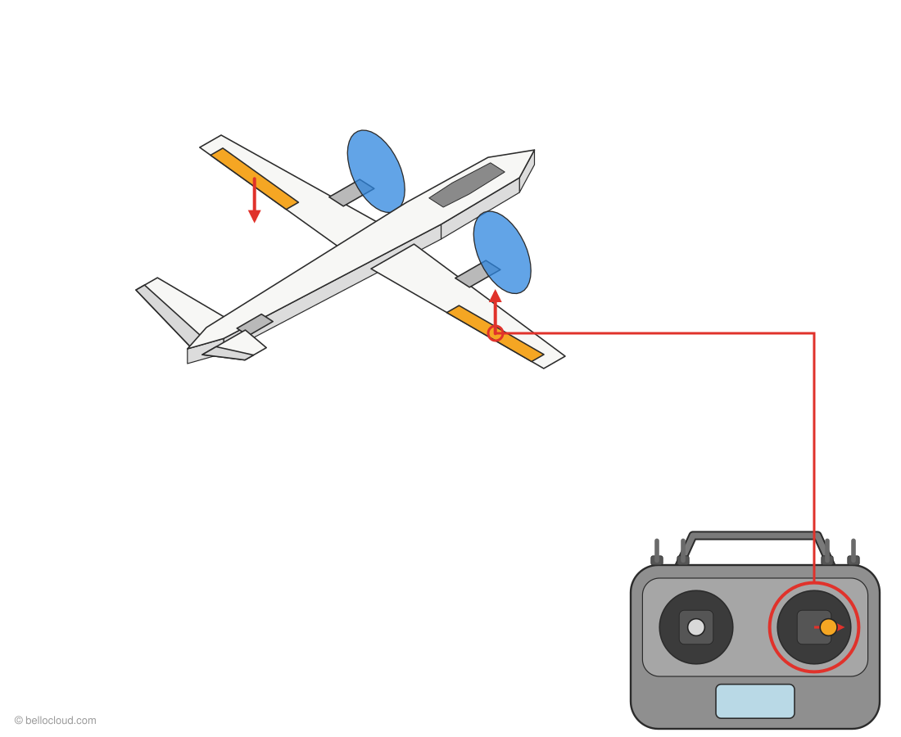

# VTOL Y3: drone that flies like a plane

**English** · [Français](fr/README.md) · [العربية](ar/README.md)

A tilt-rotor **tricopter VTOL**. It takes off and lands like a drone and flies like an airplane. Runs **ArduPlane 4.7.2** (QuadPlane) on a **Pixhawk 2.4.8**, set up with **QGroundControl 5.1.5** and a **FlySky i6X** radio.

> **Start here**
> - **Full guides in the browser:** https://soufianeblog.github.io/dronev2/ (offline: open `index.html`)
> - ✅ **Short task lists:** [`quick/`](quick/README.md)
> - 💾 **Parameter backups:** [`backups/`](backups/) · **[⬇ Download the latest backup](https://github.com/soufianeblog/dronev2/raw/main/backups/params_after-tilt-changes.params)** (`params_after-tilt-changes.params`)

## The aircraft

```
                    ▲ nose
      (M2)──────────┼──────────(M1)        front motors, each on a tilt servo
 ═════════════════ MAIN WING ═════════════════
   [aileron L]      │      [aileron R]     1 servo each
                    │
                  (M4)                      tail motor, fixed
           ╲═ tail L ═╪═ tail R ═╱          V-tail, 1 servo each
```

| Part | Job |
|---|---|
| 2 front motors (M1, M2) + 2 tilt servos | Point **up** in drone mode, tilt **forward** in airplane mode. They also steer yaw in drone mode. |
| 1 tail motor (M4) | Lift in drone mode only, **off** in airplane mode |
| 2 ailerons | Roll in airplane mode |
| 2 tail wings (V-tail) | Pitch = both move together, yaw = they move opposite |

## Controls (FlySky i6X, Mode 2)

| Control | Does |
|---|---|
| **SWA** (CH5) | **Down = arm** (motors on) · **up = off** |
| **SWC** (CH6) | **Up = QLAND** (land / idle) · **middle = QHOVER** (drone) · **down = FBWA** (airplane) |
| Left stick | ↑↓ throttle · ←→ yaw |
| Right stick | ↑↓ pitch · ←→ roll |

The Pixhawk does all the mixing. In drone mode the wing and tail surfaces fade out automatically at low speed.

## Progress

| # | Step | Full guide | Task list | Status |
|---|---|---|---|---|
| 01 | Connect and check ArduPlane | [HTML](https://soufianeblog.github.io/dronev2/guides/guide-01_2026-10-17_0113_connect-and-check-arduplane.html) | [MD](quick/01-connect-and-check.md) | ✅ |
| 02 | Update to ArduPlane 4.7.2 | [HTML](https://soufianeblog.github.io/dronev2/guides/guide-02_2026-10-17_0220_update-arduplane-4-7-2.html) | [MD](quick/02-update-firmware.md) | ✅ |
| 03 | Orientation and calibration | [HTML](https://soufianeblog.github.io/dronev2/guides/guide-03_2026-10-17_0309_orientation-and-calibration.html) | [MD](quick/03-orientation-calibration.md) | 🟡 compass after wiring |
| 05 | FlySky i6X transmitter setup | [HTML](https://soufianeblog.github.io/dronev2/guides/guide-05_2026-10-17_1421_flysky-i6x-transmitter-setup.html) | [MD](quick/05-flysky-i6x.md) | ✅ |
| 04 | Radio calibration, flight modes, arm switch | [HTML](https://soufianeblog.github.io/dronev2/guides/guide-04_2026-10-17_0345_flysky-switches-and-calibration.html) | [MD](quick/04-radio-modes-arming.md) | ✅ |
| 06 | Outputs: plug in and test servos, then motors | [HTML](https://soufianeblog.github.io/dronev2/guides/guide-06_2026-10-18_0210_outputs-and-servo-test.html) | [MD](quick/06-outputs-servo-test.md) | 🟡 |
| 07 | Radio failsafe | | | ⏳ |
| 08 | Outputs: motors, tilt servos, surfaces, directions | | | ⏳ |
| 09 | ESC calibration, motor direction | | | ⏳ |
| 10 | Transition bench test, battery failsafe | | | ⏳ |
| 11 | Pre-flight checklist, first hover | | | ⏳ |

## Reference

| Page | HTML | Markdown |
|---|---|---|
| Sticks and switches: how the aircraft moves (drawings) | [open](https://soufianeblog.github.io/dronev2/guides/ref-stick-controls.html) | [MD](quick/ref-stick-controls.md) |
| FlySky i6X: every setting changed and checked | [open](https://soufianeblog.github.io/dronev2/guides/ref-flysky-settings.html) | [MD](quick/ref-flysky-settings.md) |
| Parameter changes: before → after → what for | [open](https://soufianeblog.github.io/dronev2/guides/ref-parameter-changes.html) | [MD](quick/ref-parameter-changes.md) |



## Hardware

| Qty | Part |
|---|---|
| 1 | Pixhawk 2.4.8 combo (M8N GPS + compass, power module, buzzer, safety switch) |
| 3 | A2212/13T 1000 KV motors + 30 A ESCs |
| 6 | EMAX ES08MA II servos (2 tilt, 2 aileron, 2 tail) |
| 1 | PDB with 5 V / 12 V BEC |
| 1 | 3S 3000 mAh 60C LiPo (XT60) |
| 1 | FlySky FS-i6X + FS-iA10B receiver, connected to RC IN through a PPM encoder (receiver output: PWM) |

## Safety

Bench work is **USB only: no LiPo, no propellers**, until a guide explicitly says otherwise. Never disable the arming checks.

## Repository

| Path | Contents |
|---|---|
| `index.html` | Start page for the guides (GitHub Pages or offline) |
| `guides/` | Full HTML guides, with screenshots and logs in `guideN_screenshots/` |
| `quick/` | Short Markdown task lists |
| `backups/` | QGroundControl parameter backups |
| `docs/project-notes.md` | Working notes: verified facts, output map, full progress log, open questions |
| `fr/`, `ar/` | French and Arabic versions of everything (same layout) |
| `assets/drawings/` | Drawings (SVG) used by the guides |
| `LICENSE` | © 2026 bellocloud.com |

---
© 2026 bellocloud.com. All rights reserved.
