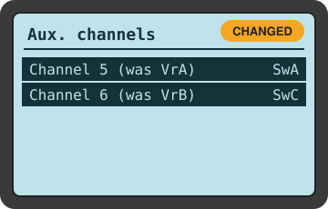
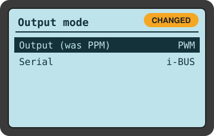

# FlySky i6X : tous les réglages en un coup d'œil

[English](../../quick/ref-flysky-settings.md) · **Français** · [العربية](../../ar/quick/ref-flysky-settings.md)

[Sommaire](README.md) · [Page complète](https://soufianeblog.github.io/dronev2/fr/guides/ref-flysky-settings.html)

Seuls **2 réglages ont été modifiés**. 9 autres écrans ont été vérifiés et étaient déjà corrects.

## Touches

| Action | Touche |
|---|---|
| Ouvrir le menu | **maintenir OK** (2 s) |
| Se déplacer / modifier une valeur | **UP / DOWN** |
| Ouvrir un élément · champ ou voie suivant | **appui court sur OK** |
| Revenir sans enregistrer | **CANCEL** |
| Enregistrer et revenir | **maintenir CANCEL** (2 s) |

## Modifiés (2)

### Functions setup → Aux. channels

| Avant | Après |
|---|---|
| Channel 5 = VrA · Channel 6 = VrB | Channel 5 = **SwA** · Channel 6 = **SwC** |

SWA arme/désarme désormais (Pixhawk `RC5_OPTION=153`). SWC choisit désormais le mode de vol (Pixhawk `FLTMODE_CH=6`). Les potentiomètres VrA/VrB ne sont plus utilisés.

### System setup → RX setup → Output mode

| Avant | Après |
|---|---|
| PPM | **PWM** (Serial : i-BUS) |

Une carte encodeur PPM se trouve entre le récepteur et le RC IN du Pixhawk. Elle a besoin d'un signal PWM par voie et construit elle-même le PPM. En PPM, le Pixhawk voyait des valeurs figées ; en PWM, tout fonctionne.

## Vérifiés, laissés tels quels

| Écran | Valeur | Pourquoi |
|---|---|---|
| System setup → Type select | Airplane | Voies simples, pas de mixage hélicoptère |
| System setup → Sticks mode | 2 | Gauche : gaz ↑↓, lacet ←→ · Droite : tangage ↑↓, roulis ←→ |
| System setup → Aux switches | Tous activés · Ch 10 | Interrupteurs utilisables, assez de voies transmises |
| Functions setup → V Tail · Elevon · Mixes · Throttle hold | Tous Off | Le Pixhawk fait tous les mixages ; un double mixage fausserait le tangage/lacet |
| Functions setup → Throttle curve | 0 / 25 / 50 / 75 / 100 % | Ligne droite : le Pixhawk voit la position réelle du manche |
| Functions setup → Dual rate/exp. | Ch1, Ch2, Ch4 : 100 / 0 | Course complète, sans adoucissement (nécessaire pour la calibration) |
| Functions setup → Assign switches | Tous None | SWA/SWC ne déclenchent aucune fonction de l'émetteur |
| Functions setup → Reverse · End points · Subtrim | Nor · 100/100 % · 0 | Aucune voie inversée, course complète, vrai centre |
| Functions setup → Display (test) | Chaque commande ne bouge que sa barre | Prouve que le côté émetteur est correct |

## Résultat : affectation des voies

| Voie | Commande | Utilisation par le Pixhawk |
|---|---|---|
| Ch1 | Manche droit ←→ | Roulis |
| Ch2 | Manche droit ↑↓ | Tangage |
| Ch3 | Manche gauche ↑↓ | Gaz |
| Ch4 | Manche gauche ←→ | Lacet |
| Ch5 | SWA | Armer (bas) / désarmer (haut) |
| Ch6 | SWC | QLAND (haut) · QHOVER (milieu) · FBWA (bas) |

> ⚠️ **N'ouvrez jamais RX setup → RF standard.** Le modifier peut rompre la liaison avec le récepteur.

---
© 2026 bellocloud.com
