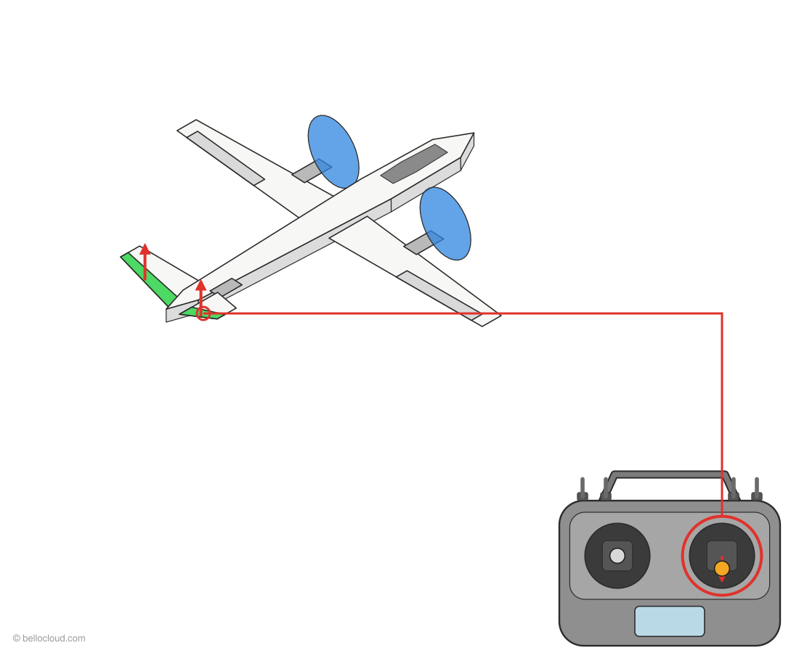
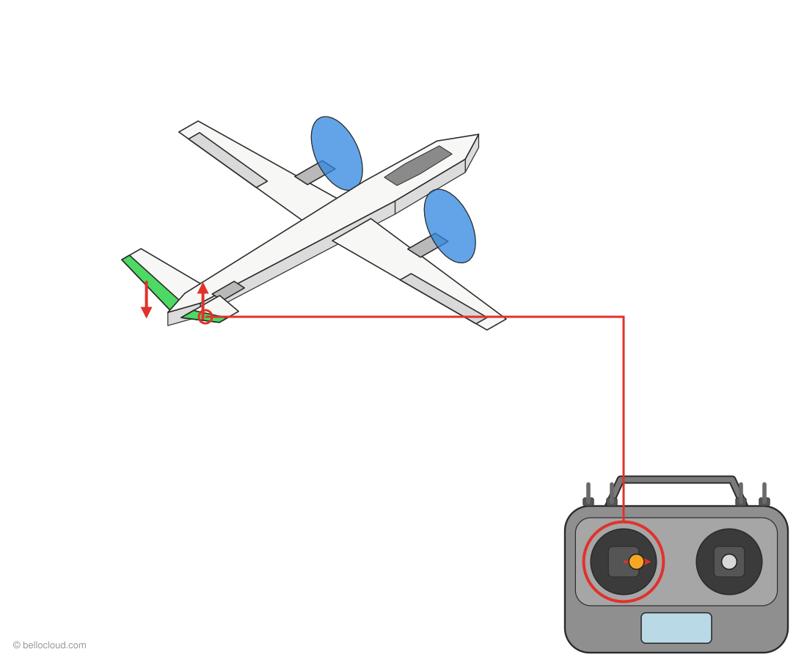
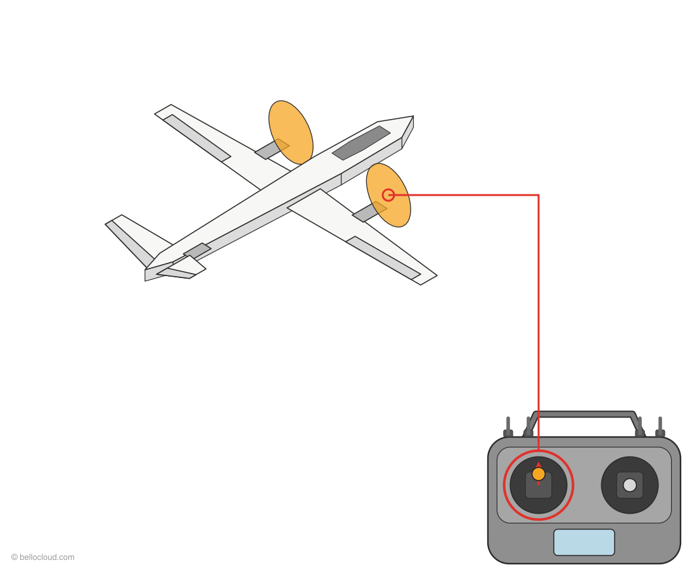
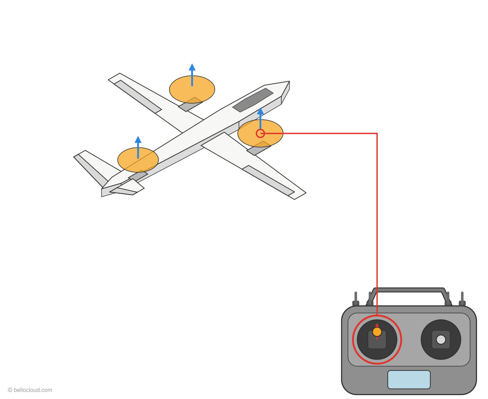
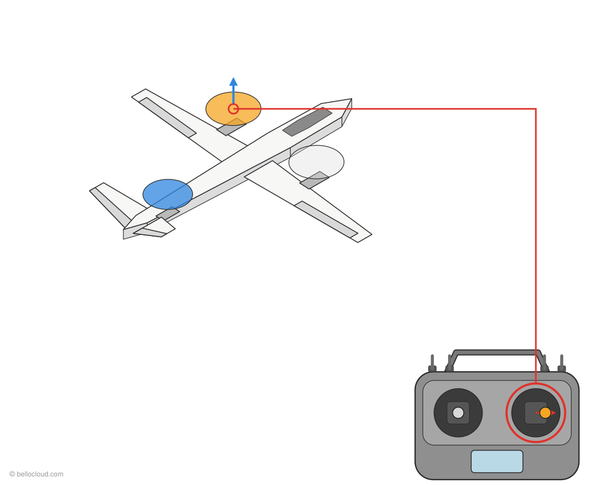
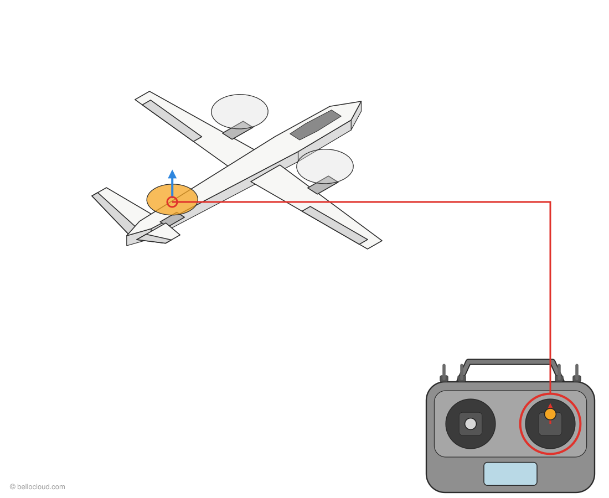
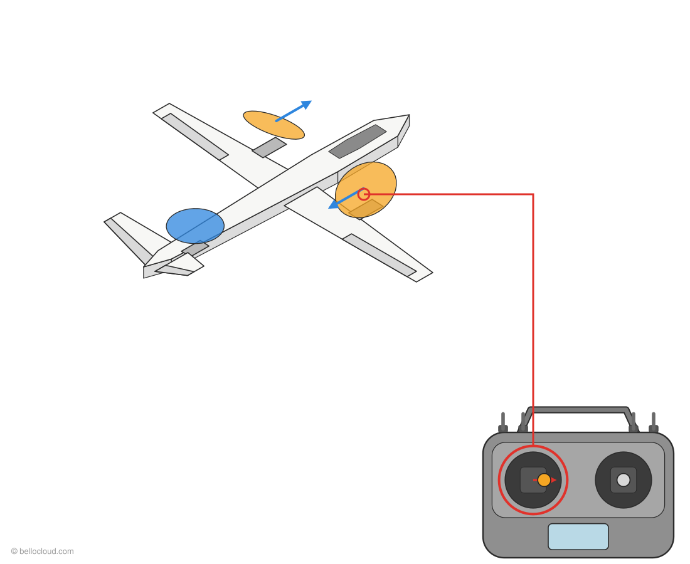
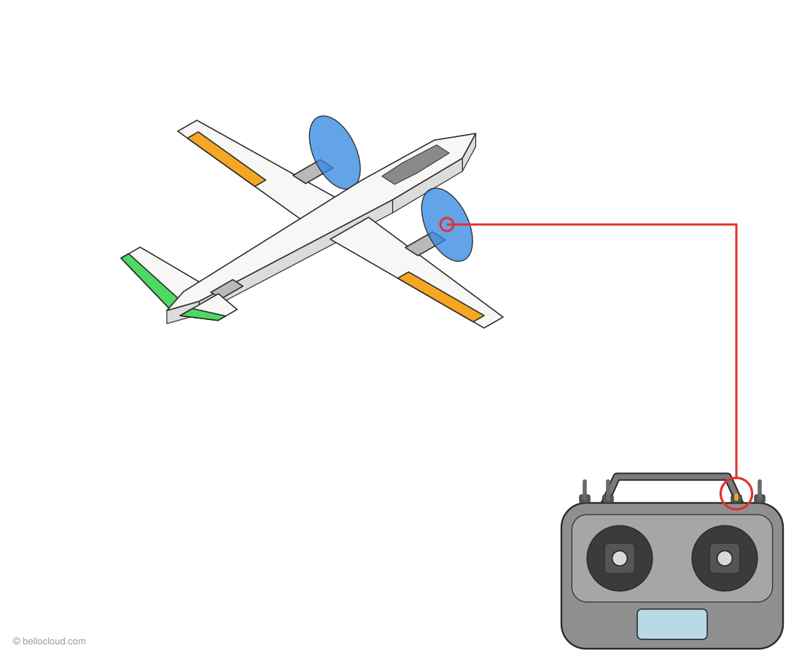
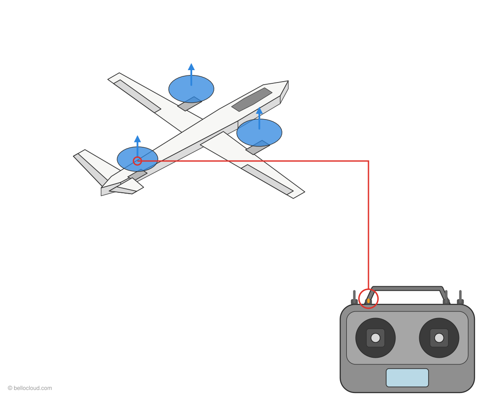

# Manches et interrupteurs : comment le VTOL Y3 bouge

[English](../../quick/ref-stick-controls.md) · **Français** · [العربية](../../ar/quick/ref-stick-controls.md)

[Sommaire](README.md) · [Page complète](https://soufianeblog.github.io/dronev2/fr/guides/ref-stick-controls.html)

**Légende :** cercle rouge = ce que vous bougez · trait rouge = ce sur quoi il agit · orange = aileron / moteur plus rapide · vert = empennage en V · bleu = hélice en rotation · flèches = sens.

## Mode avion (SWC en bas, FBWA)

### Roulis à droite

**Mouvement :** Manche droit → **à droite**  
L'aileron gauche **descend**, l'aileron droit **monte**. L'avion s'incline à droite. Manche à gauche = l'inverse.

### Cabrer

**Mouvement :** Manche droit ↓ **tiré vers vous**  
Les deux gouvernes de queue **montent** ensemble. Le nez se lève.

### Piquer

**Mouvement :** Manche droit ↑ **poussé vers l'avant**  
Les deux gouvernes de queue **descendent** ensemble. Le nez s'abaisse.

### Lacet à droite

**Mouvement :** Manche gauche → **à droite**  
La gouverne de queue droite **monte**, la gauche **descend** (empennage en V). Le nez tourne à droite.

### Plus vite

**Mouvement :** Manche gauche ↑ **vers le haut**  
Les deux moteurs avant (basculés vers l'avant) tournent plus vite. Le moteur arrière reste arrêté.

## Mode drone (SWC au milieu, QHOVER)

> Les gouvernes de l'aile et de la queue bougent à peine en mode drone : ArduPlane les efface à basse vitesse. Ce sont les moteurs et les servos de bascule qui pilotent.

### Monter

**Mouvement :** Manche gauche ↑ **vers le haut**  
Les 3 moteurs accélèrent. L'appareil monte. En QHOVER, manche au milieu = maintien de l'altitude.

### Roulis à droite

**Mouvement :** Manche droit → **à droite**  
Le moteur avant **gauche** accélère, le droit ralentit. L'appareil s'incline et se déplace vers la droite.

### Avancer

**Mouvement :** Manche droit ↑ **poussé vers l'avant**  
Le moteur **arrière** accélère, les moteurs avant ralentissent. Le nez plonge et l'appareil avance.

### Tourner à droite

**Mouvement :** Manche gauche → **à droite**  
Les servos de bascule inclinent le moteur **gauche** vers l'avant et le moteur **droit** vers l'arrière. L'appareil tourne à droite sur place.

## Interrupteurs

### Armer

**Mouvement :** SWA ↓ **en bas**  
Moteurs armés (seulement si toutes les vérifications de sécurité passent). **SWA en haut = moteurs coupés immédiatement.**

### Armer au manche

**Mouvement :** manche gauche ↓ + → **3 s**  
Arme aussi (`ARMING_RUDDER = 2`). Manche gauche ↓ + ← pendant 2 s = désarmer. Les gaz doivent être tout en bas.

### Mode drone, direct

**Mouvement :** SWC ↑ **en haut** = QSTABILIZE  
Les moteurs avant pointent vers le haut. Le manche des gaz règle directement la puissance des moteurs : pas de maintien d'altitude. Utilisé pour les premiers tests moteurs.

### Mode drone

**Mouvement :** SWC **au milieu** = QHOVER  
Les moteurs avant pointent vers le haut, les 3 moteurs assurent la portance. Manche des gaz au milieu = maintien de l'altitude.

### Mode avion

**Mouvement :** SWC ↓ **en bas** = FBWA  
Les moteurs avant basculent vers l'avant, le moteur arrière s'arrête, les ailerons et l'empennage en V pilotent.

### Retour au point de départ

**Mouvement :** SWB ↓ **en bas** = QRTL  
Revient au point de décollage en drone et atterrit à la verticale (`Q_RTL_MODE = 3`). SWB en haut = retour au mode de SWC. Gardez SWB en haut pour armer.

> ⚠️ Chaque sens est vérifié sur l'appareil réel, hélices retirées, dans le Guide 06 (sorties) avant le premier vol.

---
© 2026 bellocloud.com
